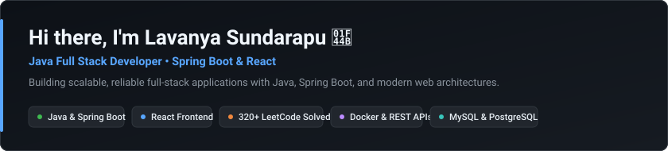
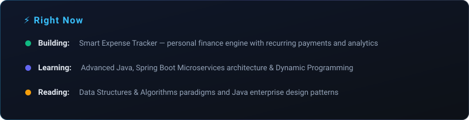
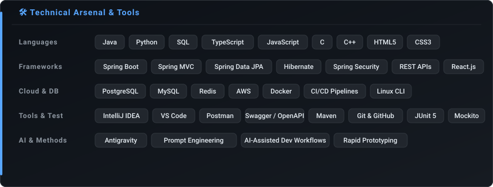
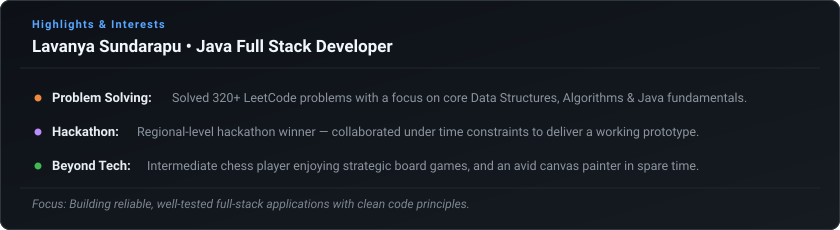
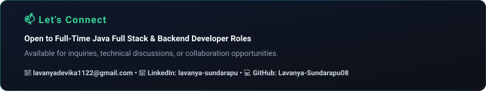

<!-- Intro Card -->

  

<!-- Quick Social Links (Directly Clickable) -->

&nbsp;

&nbsp;

&nbsp;

  

<!-- Right Now Card -->

  

<!-- Toolkit Card -->

  

<!-- Featured Projects Table -->
<table width="100%">
  <thead>
    <tr>
      <th align="left">🌟 Featured Projects</th>
      <th align="left">Description</th>
      <th align="center">Stack</th>
      <th align="center">Status</th>
    </tr>
  </thead>
  <tbody>
    <tr>
      <td><b><a href="https://github.com/Lavanya-Sundarapu08/CareerSync">CareerSync</a></b></td>
      <td>Recruitment platform with automated response deadlines and skill-matching algorithms.</td>
      <td align="center"><code>Java</code> <code>Spring Boot</code> <code>React</code></td>
      <td align="center">🔨 <i>In Progress</i></td>
    </tr>
    <tr>
      <td><b><a href="https://github.com/Lavanya-Sundarapu08/Candor">Candor</a></b></td>
      <td>Code Review Quality Checker detecting weak PR approvals and code-testing gaps.</td>
      <td align="center"><code>Python</code> <code>Spring Boot</code> <code>GitHub API</code></td>
      <td align="center">🔨 <i>In Progress</i></td>
    </tr>
    <tr>
      <td><b><a href="https://github.com/Lavanya-Sundarapu08/Smart-Expense-Tracker">Smart Expense Tracker</a></b></td>
      <td>Expense and budget management system with recurring payment automation and analytics.</td>
      <td align="center"><code>Java</code> <code>Spring Boot</code> <code>PostgreSQL</code></td>
      <td align="center">🚀 <i>Coming Soon</i></td>
    </tr>
  </tbody>
</table>

 

<!-- LeetCode & GitHub Activity Stats -->
<table width="100%" border="0">
  <tr>
    <td width="50%" align="center">
      
    </td>
    <td width="50%" align="center">
      
    </td>
  </tr>
</table>

 

<!-- Developer Trading Card -->

  

<!-- Say Hi / Contact Card -->

